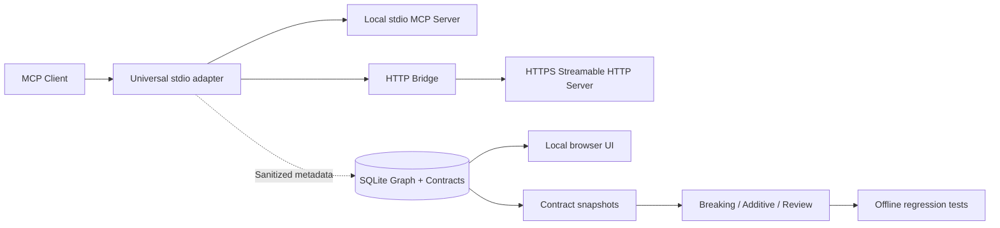

# FARADAY Graph — plug & use for MCP systems

**Build 005: Universal Adapter (Iterations 1–4 + HTTP bridge)** — discovery, runtime observation, structural contracts, impact analysis, local packaging and reversible installation.

> See what your MCP agents depend on, observe what they invoke, detect breaking tool contract changes, and introduce FARADAY without changing your prompts or orchestration code.

**Status:** local, offline-first development tool. **Not** a mandatory security gateway, code semantic indexer, real agent identity provider, or proof of zero-bypass execution. It is not yet published to npm. No claims of production certification or universal compatibility.

## Requirements

- Node.js >=22.16 with built-in `node:sqlite` (an experimental warning may appear under Node 22).
- For observation: a compatible MCP client using **stdio**, including a Streamable HTTP server reachable via the stdio-to-HTTP adapter (HTTPS or loopback HTTP).
- Permission to read and optionally modify the chosen MCP configuration file. Global scans require explicit `--include-global`.

## Five-minute local installation

```bash
# From the cloned repository:
cd agentic
npm link                    # installs 'faraday' locally/globally using npm link
faraday init --root /path/to/agent-project
faraday doctor --root /path/to/agent-project
faraday onboard --root /path/to/agent-project
faraday scan --root /path/to/agent-project
faraday serve --db /path/to/agent-project/.faraday/graph.sqlite
```

The web UI prints a loopback URL with a one-time access token. Only metadata is stored locally. `init` creates `.faraday/graph.sqlite` and adds `.faraday/` to `.gitignore` when necessary. `init --dry-run` previews these changes; **no MCP servers are executed** during discovery or initialization.

### Observe real calls, reversibly

```bash
faraday install --dry-run --config /path/to/agent-project/.mcp.json --server my-server
faraday install --config /path/to/agent-project/.mcp.json --server my-server
# Restart the MCP client and call existing tools.
faraday serve --db /path/to/agent-project/.faraday/graph.sqlite

# To restore the original server entry:
faraday uninstall --config /path/to/agent-project/.mcp.json --server my-server
```

If not using the working directory as the graph location, pass the same explicit `--db` to `install`, `serve`, `scan` and `contracts snapshot`:

```bash
faraday install --config /path/to/agent-project/.mcp.json --server my-server \
  --db /path/to/agent-project/.faraday/graph.sqlite
```

The installer wraps one selected **strict-JSON stdio or Streamable HTTP MCP server** and privately backs up the original launch entry in `.faraday/targets/`. Backups may contain credentials and must remain private. For stdio it forwards the original wire bytes unchanged. For HTTP servers it converts JSON-RPC stdio frames into authenticated HTTP POST requests and translates JSON/SSE responses back into JSON-RPC stdio frames, passing authorized tool calls through to the existing upstream. **The HTTP bridge is not transparent at the transport layer**, and neither adapter enforces Gate policies. `uninstall` refuses to overwrite a wrapper modified externally.

### Iteration 3 — Contracts and impact analysis

After using a client that sends `tools/list` through the proxy, capture a baseline:

```bash
faraday contracts snapshot --db .faraday/graph.sqlite --out .faraday/baseline.json
# Update a server or MCP dependency, reconnect, and invoke tools/list again.
faraday contracts snapshot --db .faraday/graph.sqlite --out .faraday/current.json
faraday contracts compare --base .faraday/baseline.json --current .faraday/current.json
faraday contracts compare --base .faraday/baseline.json --current .faraday/current.json --json
faraday contracts compare --base .faraday/baseline.json --current .faraday/current.json --fail-on-breaking
# Exit code 2 if a breaking structural change is detected.
```

Changes are classified as **breaking**, **additive**, or **review**. Breaking examples: previously observed tool removed, input property removed, newly required property, narrowed accepted types, and `additionalProperties` newly forbidden. Output changes are conservatively marked for review. Possible affected clients are inferred from **configured topology**; FARADAY cannot certify they are live consumers.

Generate a runnable offline regression test:

```bash
faraday contracts generate \
  --base .faraday/baseline.json \
  --current .faraday/current.json \
  --out .faraday/regression
node --test .faraday/regression/contracts.regression.test.mjs
```

The test imports `@faraday/agentic/contracts`. The package must be installed or linked **in the agent workspace**, e.g. `npm install --save-dev /absolute/path/to/faraday/agentic` or `npm link @faraday/agentic`. The generated test loads both JSON snapshots at run time and checks for breaking changes **without calling any real tools**. To validate future changes, refresh `current.json` and rerun (generate again if using a separate output folder). Onboarding is easiest if generated tests live in the agent repository.

**Coverage limit:** the tool schema is normalized and privacy-reduced. FARADAY ignores descriptions, defaults, enum literals, numeric bounds, patterns, examples and arbitrary extension constraints. A difference only in those fields is not detected; an unchanged result is **not proof of compatibility**. The graph does not know tools that were not returned by an observed `tools/list` response. When a **complete** observed `tools/list` finishes, its server contract set is replaced, so removed tools are detected. Partial or failed pages are not treated as complete. If a server never refreshes `tools/list`, previously observed contracts remain and coverage is stale.

### Iteration 4 — Plug & Use / diagnostics

```bash
faraday init --root . --dry-run  # preview before writing
faraday init --root .            # idempotent workspace bootstrap
faraday doctor --root .          # local checks; no network
faraday doctor --root . --json   # machine-readable report
faraday graph --format mermaid > topology.mmd
npm run test:all
npm pack --dry-run               # check contents of a local distributable
```

**Supported formats:** `.mcp.json`, `.cursor/mcp.json`, `.vscode/mcp.json`, `mcp.json`; `mcpServers` and VS Code `servers`. Global discovery is optional. Streamable HTTP can be observed through an installed stdio-to-HTTP bridge on clients supporting stdio. Legacy HTTP+SSE (`type: "sse"`) is inventoried but not bridged. Modern request-scoped SSE is supported; independent legacy GET streams, resumable SSE and all possible MCP protocol-version combinations are not supported. JSONC with comments can be scanned only if valid strict JSON and is deliberately not rewritten.

**Safe rollback:** `uninstall` restores each instrumented server from a private backup; it does not delete collected events or database files. To remove local graph data, stop the viewer, inspect `.faraday/` and delete it manually. No automatic destructive cleanup is performed.

## Command reference

```text
faraday init [--root PATH] [--dry-run]
faraday doctor [--root PATH] [--json]
faraday onboard [--root PATH] [--json]
faraday scan [--root PATH] [--db PATH] [--include-global] [--json]
faraday install --config FILE --server NAME [--db PATH] [--dry-run]
faraday uninstall --config FILE --server NAME
faraday hook --config FILE --server NAME [--db PATH]
faraday proxy --config FILE --server NAME [--db PATH] [--debug-stderr]
faraday bridge --config FILE --server NAME [--db PATH]
faraday graph [--db PATH] [--format json|mermaid]
faraday contracts snapshot [--db PATH] --out FILE
faraday contracts compare --base FILE --current FILE [--json] [--fail-on-breaking]
faraday contracts generate --base FILE --current FILE --out DIR
faraday serve [--db PATH] [--port N]
faraday demo
```

## Architecture



## Privacy and security

- No model prompts, full tool arguments, results, raw HTTP URLs, environment variable values or schema descriptions are recorded by Graph. Only conservative structural schemas and metadata are stored. Some tool/property names can still be revealing, so treat `.faraday` as private.
- For remote MCP, the adapter forwards configured auth headers in memory, follows **no redirects**, and refuses plaintext non-loopback URLs. HTTP credentials are retained only in the private mode-0600 configuration backup, not in events. Environment placeholders like `${MCP_TOKEN}` are resolved at runtime from the bridge process environment.
- The proxy executes the previously configured command with its provided environment. **Do not** use untrusted MCP configurations. `init`, `doctor`, `scan`, `contracts` and `serve` do not execute tools.
- A local HTTP viewer binds exclusively to `127.0.0.1`, uses an ephemeral session key and `no-store` responses. Do not share its URL.
- Graph is an **observer**, not an enforcement/security boundary. Client workflows using direct API calls or another uninstrumented MCP path are invisible.
- Runtime graph captures latest structural contract per `server/tool`, **not** a full immutable version history. Capture separate versioned snapshots before/after each change.
- The generated regression suite is structural and cannot prove business-level behavior without domain-specific tests.

## Test & release readiness

`npm test` runs offline unit and integration tests, including real child process MCP forwarding, SQLite persistence, safe contract scrubbing and comparisons, generated regression execution, safe setup and idempotence, viewer authentication and no-leak expectations. CI runs on Node.js 22 and 24 and exercises an actual local HTTP MCP server (JSON and SSE responses), as well as the existing stdio integration and security regressions.

The npm package is deliberately marked `private` until validated for public distribution. You can use `npm link` or local `npm install` without publishing it.

## Build 005 — Universal Adapter onboarding

**Fastest path** (from a project that already has an MCP config):

```bash
faraday init --root . --dry-run
faraday init --root .
faraday onboard --root .
faraday install --dry-run --config .mcp.json --server MY_SERVER
faraday install --config .mcp.json --server MY_SERVER
# Restart your MCP client; the first tools/list event populates the graph.
faraday serve --db .faraday/graph.sqlite
# Restore the original entry without changing other servers:
faraday uninstall --config .mcp.json --server MY_SERVER
```

`onboard` gives a JSON plan with the detected project config paths and install arguments. It never executes an MCP server or writes its config. `install --dry-run` validates the target but never writes files. The installation rewrites **one server entry** to launch FARADAY over stdio, with a private rollback file in the configuration directory's `.faraday/targets/` folder.

For Streamable HTTP sources (e.g. `type: "http"` and `url: "https://mcp.example/mcp"`), the new `faraday bridge` provides an stdio-to-HTTP adapter. Client HTTP headers are sourced from the original private config, with `${ENV_VAR}` placeholders supported; the bridge never prints or persists their values. This is an adapter for an existing stdio-compatible MCP client, **not** an always-on public HTTP gateway, and changing the server entry requires restarting the client.

### Tested transport scope

- ✅ MCP stdio clients with JSON-RPC newline framing and locally launched stdio servers.
- ✅ Stdio client to local Streamable HTTP fixture using JSON response or request-scoped SSE response.
- ✅ Optional session ID header propagation on earlier Streamable HTTP servers.
- ✅ Tool contract and structured header mirroring (`Mcp-Method`, `Mcp-Name`, subset of `x-mcp-header`).
- ✅ Remote URL restrictions (HTTPS mandatory except loopback HTTP); no HTTP redirects (protects credentials).
- ✅ Offline install preview, private backup and explicit uninstall.
- ⚠️ The 2026-07-28 transport introduced new per-request metadata requirements. This adapter passes through client metadata and cannot automatically translate every older stdio client into modern MCP semantics.
- ⚠️ Legacy HTTP+SSE server-initiated GET streams, resumable SSE, custom protocol extensions, `x-mcp-header` in composition schemas and non-stdio clients remain outside this tested scope.
- ⚠️ This is observational integration, not a provably enforced zero-trust boundary. The existing tools execute normally and remain accessible through any uninstrumented routes.

**Privacy:** URLs and bearer tokens from the configuration are not written to Graph. All credentials should remain private in project configs and private backups, not committed to version control. Even sanitized tool and property names may reveal information; protect `.faraday/`.
