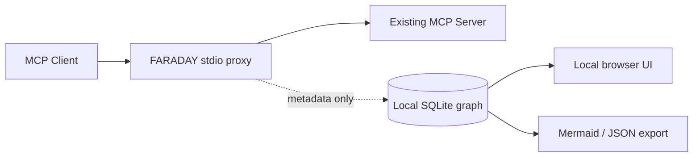

# FARADAY Graph — plug-in agentic topology

**Iteration 1 — Discovery** and **Iteration 2 — Runtime Graph** are implemented in this folder.

> Discover what tools your agents can access, then observe which MCP tools they actually call. FARADAY does not change the agent's prompts, responses or tool execution policy.


## Requirements

- **Node.js 22.16+**, with built-in `node:sqlite`. Node 22 shows a benign experimental SQLite API warning. SQLite requires no native or third-party npm module.
- Compatible **MCP stdio** servers for runtime observation. Config discovery also inventories HTTP MCP servers, but does **not** proxy them in Iteration 2.
- Local machine permission to read a workspace's MCP configuration. Optional global discovery is **opt-in**.

## Install locally (no npm package has been published)

```bash
cd agentic
npm link
faraday demo  # generates a sample graph; executes no real tools
faraday scan --root /path/to/project
faraday graph --format mermaid
faraday serve
```

The `serve` command prints a one-time local URL. Open it in your browser. The graph includes client configurations, MCP servers, discovered tools and observed calls. The webpage is read-only and listens only on `127.0.0.1` with an ephemeral access cookie.

The `scan` command only reads *known* project files: `.mcp.json`, `.cursor/mcp.json`, `.vscode/mcp.json`, `mcp.json`; add `--include-global` to examine supported home-based Claude Desktop, Cursor, Copilot CLI and Windsurf configurations. It never starts any server, contacts remote endpoints or reads the codebase. A `server` in the graph means **configured**, not confirmed reachable.

## Enable passive runtime observation

**Option A — automatic reversible patch** for a strict-JSON MCP config:

```bash
faraday install --config /path/to/project/.mcp.json --server my-server
# Restart the agent client and use the MCP tools normally.
faraday serve
# To restore the exact original server configuration:
faraday uninstall --config /path/to/project/.mcp.json --server my-server
```

`install` replaces only the chosen server entry with a proxy wrapper. It copies the original launch entry to a mode-0600 file within the configuration folder's `.faraday/targets/` directory so the proxy starts the original MCP server **without recursion**. The backup can contain secrets; do **not** commit or share `.faraday`. The same file is used for uninstall. The auto-installer preserves other JSON object entries but reformats JSON; use a VCS diff if its formatting matters. It deliberately refuses to rewrite commented JSONC.

**Option B — no modification**:

```bash
faraday hook --config /path/to/project/.mcp.json --server my-server
```

This prints a proxy entry to install manually. Keep the original server configuration in a **separate** file path; do not point the wrapper to itself. The proxy may be used directly:

```bash
faraday proxy --config /path/to/original.mcp.json --server my-server --db /path/to/project/.faraday/graph.sqlite
```

The runtime passively observes JSON-RPC messages, forwards *unchanged bytes*, records method, tool name, outcome and approximate latency; indexes tools from `tools/list`; and never stores prompts, full tool arguments, URLs, environment variable values or response bodies. Graph names use a strict allowlist and are hashed/redacted if suspicious.

### Useful commands

```bash
faraday scan --root . --json
faraday scan --root . --include-global
faraday graph --format json
faraday graph --format mermaid > topology.mmd
faraday serve --port 0
npm test
```

SQLite graph defaults to `.faraday/graph.sqlite`, located under the current working directory. Pass `--db /absolute/path/graph.sqlite` to point all commands at the same database if needed.

## What is actually supported

| Capability | Status |
| --- | --- |
| Project MCP config discovery (`mcpServers`, VS Code `servers`) | ✅ |
| Opt-in global discovery | ✅ |
| HTTP server inventory without outbound requests | ✅ |
| SQLite nodes, relationships, event history | ✅ |
| Mermaid/JSON graph export | ✅ |
| stdio MCP transparent proxy with bidirectional JSON-RPC | ✅ |
| `initialize`, `tools/list`, `tools/call`, notifications, JSON-RPC batches | ✅ observed, bytes forwarded |
| Auto-install and rollback selected strict-JSON server | ✅ |
| Local interactive SVG graph + recent events | ✅ |
| Automatic CodeGraph-like source-code and dependency indexing | ❌ not implemented |
| Parse comments/trailing commas in JSONC configuration files | ❌ not implemented |
| Streamable HTTP/SSE transparent proxy | ❌ future adapter |
| Intercept tool calls outside the configured proxy | ❌ impossible without routing/enforcement changes |
| Any MCP tool calls blocked or authorized by Gate | ❌ **observation only** |

## Privacy & security

- The proxy **executes the command already configured in your MCP server**. Never install it on untrusted configs. `scan`, `graph`, `hook`, and `serve` do **not** run MCP tools.
- Only local graph metadata is stored. Some tool/server names can still be sensitive, so treat `.faraday` as private. `.faraday/` must be in `.gitignore`.
- The proxy is **not** a sandbox or mandatory zero-trust gateway. Agents can bypass it with direct network/API access, and the host can read the local data. No claim of no-bypass enforcement is made.
- The CLI does not send telemetry, perform remote scans or contact cloud APIs. There is no production-grade audit receipt, workload attestation or key custody in Graph.
- `serve` is local-only and requires a one-time token; close it when done. Don't share the temporary URL.
- `--debug-stderr` deliberately forwards the MCP server's stderr; use only if you accept that server logs may expose secrets.
- The initial snapshot is *structural*, not semantic: without runtime calls it cannot infer hidden tools, orchestration routes, implicit API usage, or other agents' code.

## Architecture



The entire proxy is Node standard library. For safety and portability it uses the MCP **stdio newline-framed JSON-RPC wire format** and does not terminate/reinterpret the JSON-RPC session.

## Test

`npm test` covers configuration formats, opt-in behavior, symlink escaping, malformed configs, secret redaction, persistence, reversible install/uninstall, end-to-end real subprocess MCP proxy including `initialize`/`tools/list`/`tools/call`, error responses, and local browser authentication. Tests use no real APIs or credentials.

### Third-party references

- [MCP stdio transport](https://github.com/modelcontextprotocol/modelcontextprotocol/blob/main/docs/specification/2026-07-28/basic/transports/stdio.mdx)
- [VS Code MCP configuration reference](https://code.visualstudio.com/docs/agents/reference/mcp-configuration)
